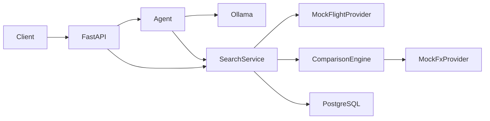

# V1 architecture

The model interprets requests and chooses a validated tool. Python executes the search, comparison and factual explanation. Native tool calls are tried first; an invalid response triggers one schema-constrained JSON decision attempt. Both paths validate the same arguments before execution. There are at most four model steps, including airport lookup and at most one repair attempt, each with a 45-second HTTP timeout. `resolve_airport`, `search_flights` and `request_clarification` are exposed. No shell, arbitrary URL, SQL or booking tool exists.

Implementation decisions compared with the proposal:

- Comparison runs automatically after search; separate comparison and retrieval tools would add unnecessary model steps for this initial workflow.
- Explanations use a deterministic Lithuanian template. Model-generated commentary and reference validation are deferred.
- History stores a complete versioned result snapshot in one SQL JSON column. Normalized tables, migrations, conversation persistence and execution audit records are deferred.
- `conversation_id` is a correlation value, not stored conversational memory. Send explicit `criteria_context` on follow-up requests. The model must still ask about ambiguous input; actual model reliability is not established by mocked tests.
- Priced synthetic itineraries are VNO–LHR and VNO–MIA. Airport lookup is global through the bundled OurAirports reference snapshot. Connecting-flight validation, live provider capabilities belong to subsequent work.

Production database: PostgreSQL through SQLAlchemy/psycopg. SQLite is exclusively a lightweight integration-test backend. Blocking database work currently runs in the request path; production concurrency work is outside this local milestone.

Data provenance is explicit on results and offers. Search snapshots contain the FX identifier and comparison version; synthetic rates are versioned in source. Real mode is rejected at schema validation. No API secret is committed. Configure future secrets through environment variables.

Verified locally: PostgreSQL round trip and a qwen2.5-coder:14b search producing the expected synthetic EUR 29.40 savings. Remaining V1 acceptance work: database migrations, persisted clarification context and tool audit, stronger adapter contracts and broader test scenarios. This is an initial working V1 implementation, not completion of all portfolio phases.

## Global reference data

`services/airports.py` loads a versioned, compressed OurAirports snapshot once per process. It ranks exact IATA/ICAO matches and scheduled-service airports, normalizes diacritics, and supports city/name/code queries. API responses mark this as REFERENCE, separate from MOCK price data. Flight searches validate airport identifiers against the catalog and reject closed/unknown entries. ICAO identifiers with IATA equivalents normalize to the IATA code. Other valid worldwide routes return NO_RESULTS with an explicit missing-inventory warning, never generated prices.

Frontend comboboxes require a selected directory record rather than sending arbitrary city text as an airport code. AI receives visible form context, can look up worldwide destinations with `resolve_airport`, and retains interpreted fields during clarification.

## React dashboard

`frontend/` uses React, Vite and Tailwind CSS with a dedicated Lected-inspired theme. Structured requests and Ollama agent requests use the same backend endpoints; the browser does not fabricate prices or calculate authoritative savings. Display charts use the returned EUR totals and savings. No historical price chart is shown without historical observations.

The browser receives no provider credentials. During local development Vite proxies same-origin `/api` calls to FastAPI. `scripts/dev.sh` launches both servers. `compose.yaml` provides a persistent local PostgreSQL service only; it is not a full production deployment.

The world map uses current airport reference coordinates. It follows selected origins/destinations immediately, and displays observed outbound connections once a result is loaded. Search-country controls select the itinerary to show; they are not fixed geographic city markers. Details show the actual synthetic itinerary. History restores saved snapshots without repricing. A separate methods screen explains equivalence and provenance.

Lected was read as a style reference only. No Lected files, application behavior or database were changed.

## SerpApi integration

REAL uses a separate PriceObservation schema because metasearch prices cannot be promoted to fare-equivalent Offer objects without complete conditions. The adapter queries the exact requested IATA route with EUR prices, bounds fan-out to three localization countries, validates returned segments/dates/currency, sanitizes provider failures and never substitutes MOCK. Round-trip returns need a subsequent selection workflow; initial prices are indicative for the outbound choice and are marked incomplete. REAL does not use mock exchange rates or compute confirmed savings.

The AI cannot change the explicit UI data mode. Global airport lookup remains available without the key. Warsaw and Tokyo metropolitan lookup supplements the source's municipality names, exposing WAW/WMI and HND/NRT choices. Credentials are loaded only by the backend; capability responses expose a configured boolean, never the key.

## Seller handoff

BookingService reconstructs the complete selected itinerary using provider selection tokens, validates the selected-flight response, and persists quoted sellers with safe handoff actions in a separate booking_quotes table. Seller price is nullable: a missing quote never inherits the initial estimate. Priced seller rows sort before unpriced checks; the lowest quoted label makes no claim about unpriced sellers. Link lifetime is 20 minutes. Google POST actions are resolved without executing JavaScript or fetching sellers server-side. The handoff performs navigation only; ticket purchase remains with the external seller.
